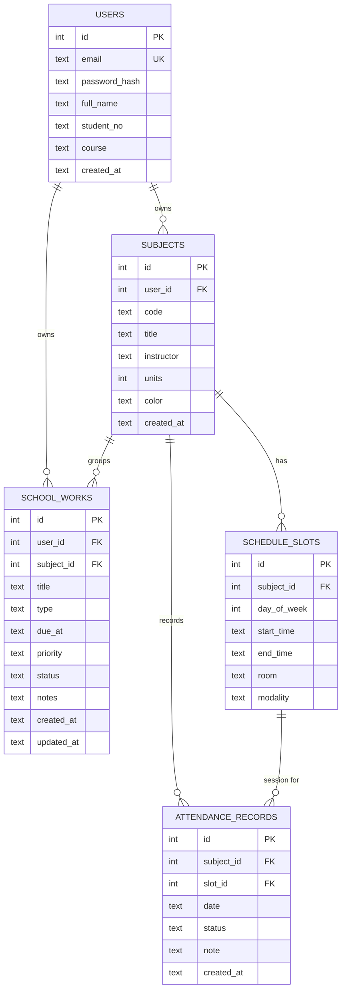

# ClassMate — Technical Plan

> Cross-platform attendance, schedule & school works tracker.
> Group 7 (PowerPuffBoys) · Start 2026-10-12 · Target 2026-11-09 · 4-week cycle.

This document is the shared technical plan for the team. The submission-ready proposal
lives in [`info.txt`](../info.txt); this file is the working reference we build from.

---

## 1. Product summary

ClassMate lets a student:

1. Register and log in (one account works on every platform).
2. Create their **subjects**.
3. Build a **weekly timetable** of class slots.
4. **Mark attendance** with one tap and watch their absence % per subject.
5. Track **school works** (assignments, quizzes, exams) with due dates.
6. Get **reminders** before class and before deadlines.
7. See a **dashboard** of today's classes, upcoming deadlines, and attendance warnings.

### Why three platforms
- **Mobile** — the everyday device: reminders fire here, one-tap attendance marking, "next class soon".
- **Web** — no-install access from a shared/lab PC: quick timetable and deadline checks.
- **Desktop** — the big-screen power view: full weekly grid and attendance reports.

---

## 2. Architecture

```
┌──────────────────────────────────────────────────────────────┐
│  Flutter client (one codebase)                               │
│  Android · iOS · Web · Windows · macOS                       │
└───────────────┬──────────────────────────────────────────────┘
                │  REST / JSON  +  Authorization: Bearer <JWT>
                ▼
┌──────────────────────────────────────────────────────────────┐
│  Node.js + Express REST API   (http://localhost:3000)        │
│  Routing · Validation · Auth middleware · Business logic     │
└───────────────┬──────────────────────────────────────────────┘
                │  better-sqlite3 (synchronous, file-based)
                ▼
┌──────────────────────────────────────────────────────────────┐
│  SQLite database file   (server/data/classmate.db)           │
└──────────────────────────────────────────────────────────────┘
```

**Tech stack**

| Layer | Choice |
|---|---|
| Client | Flutter (Dart) — `http`/`dio`, `provider`, `flutter_secure_storage`, `flutter_local_notifications`, `table_calendar` |
| API | Node.js 22 LTS + Express, `zod` validation, `cors`, `dotenv` |
| Auth | JWT + `bcrypt` password hashing |
| Database | SQLite via `better-sqlite3` |
| Tooling | VS Code, Android Studio, Postman/Thunder Client, DB Browser for SQLite |

---

## 3. Repository layout

```
PowerPuffBoys/
├── client/                 Flutter app (all platforms)
│   ├── lib/
│   │   ├── main.dart
│   │   ├── api/            API client + endpoints
│   │   ├── models/         Subject, ScheduleSlot, Attendance, SchoolWork
│   │   ├── providers/      state (auth, subjects, schedule, ...)
│   │   ├── screens/        auth, dashboard, schedule, attendance, works
│   │   └── widgets/        shared UI components
│   └── pubspec.yaml
├── server/                 Node + Express REST API
│   ├── src/
│   │   ├── index.js        app entry / server bootstrap
│   │   ├── db.js           SQLite connection + schema + seed
│   │   ├── middleware/     auth (JWT), error handler, validation
│   │   └── routes/         auth, subjects, schedule, attendance, works, dashboard
│   ├── data/               classmate.db (gitignored)
│   ├── .env.example
│   └── package.json
├── docs/
│   ├── plan.md             you are here
│   └── team-notes.md       session log + conflict drill
├── profiles/
├── info.txt                project proposal
├── CONTRIBUTING.md         Git/GitHub rulebook
└── README.md
```

---

## 4. Data model (ERD)



**Notes**
- `attendance_records.status` ∈ `present | absent | late | cancelled`.
- `school_works.type` ∈ `assignment | quiz | exam | project`; `priority` ∈ `low | medium | high`;
  `status` ∈ `todo | doing | done`.
- `subject_id` on `school_works` is nullable (a work can be unassigned).
- **Attendance % is computed, never stored** — `present / (present + absent + late)`
  per subject. This keeps the number honest if records are edited.
- Every table is scoped to the owning `user_id`; the API filters by the JWT user so one
  account can never read another's data.

---

## 5. REST API reference

Base URL: `http://localhost:3000/api`
All routes except register/login require `Authorization: Bearer <token>`.

### Auth
| Method | Path | Description |
|---|---|---|
| POST | `/auth/register` | Create account → returns JWT + user |
| POST | `/auth/login` | Authenticate → returns JWT + user |
| GET | `/auth/me` | Current user profile |

### Subjects
| Method | Path | Description |
|---|---|---|
| GET | `/subjects` | List current user's subjects |
| POST | `/subjects` | Create subject |
| GET | `/subjects/:id` | Get one subject |
| PUT | `/subjects/:id` | Update subject |
| DELETE | `/subjects/:id` | Delete subject |

### Schedule
| Method | Path | Description |
|---|---|---|
| GET | `/schedule?day=` | List slots (optionally filter by day 0–6) |
| POST | `/schedule` | Create slot |
| PUT | `/schedule/:id` | Update slot |
| DELETE | `/schedule/:id` | Delete slot |

### Attendance
| Method | Path | Description |
|---|---|---|
| GET | `/attendance?subjectId=&from=&to=` | List records |
| POST | `/attendance` | Mark a session |
| PUT | `/attendance/:id` | Update a record |
| DELETE | `/attendance/:id` | Delete a record |
| GET | `/attendance/summary` | Per-subject % + absence counts |

### School Works
| Method | Path | Description |
|---|---|---|
| GET | `/works?status=&subjectId=&dueBefore=` | List/filter works |
| POST | `/works` | Create work |
| GET | `/works/:id` | Get one work |
| PUT | `/works/:id` | Update work |
| PATCH | `/works/:id/status` | Change status only |
| DELETE | `/works/:id` | Delete work |

### Dashboard
| Method | Path | Description |
|---|---|---|
| GET | `/dashboard/today` | Today's classes + due-soon works + attendance warnings |

**Conventions**
- JSON in / JSON out. Errors: `{ "error": { "message": "...", "details": [...] } }`
  with proper status codes (400 validation, 401 auth, 404 not found, 409 conflict).
- Timestamps are ISO-8601 strings; dates are `YYYY-MM-DD`; times are `HH:MM`.

---

## 6. Scope & the MVP line

**Must ship (MVP):** auth, subjects, schedule (day view + weekly grid), attendance
marking + per-subject %, school works list + editor, dashboard.

**Stretch (only if ahead):** local reminders/notifications, attendance reports/export,
priority sorting polish, dark mode.

**Cut / future work:** QR check-in, multi-user class sharing, image uploads, cloud push,
offline sync, chat.

---

## 7. 4-week schedule

| Week | Dates | Focus | Milestone |
|---|---|---|---|
| 1 | Oct 12–18 | Proposal + plan; server scaffold; DB schema; auth | M1 — API runs, register/login works |
| 2 | Oct 19–25 | Core REST APIs; Flutter scaffold; auth screens; subjects UI | M2 — full API + login from the app |
| 3 | Oct 26–Nov 1 | Schedule + attendance + works UI; dashboard | M3 — all screens usable on Android |
| 4 | Nov 2–8 | Reminders; cross-platform verification; polish; docs; demo | M4 — demo-ready, verified on 3 platforms |

**Demo day:** Nov 9, 2026.

---

## 8. Work split (adjustable)

| Area | Owner |
|---|---|
| Project management, repo/PR reviews, API design | Nick |
| Backend APIs (auth, subjects, schedule, attendance, works, dashboard) | Nick |
| Database schema, seed data, data integrity | Jetlee |
| Flutter client: scaffold, screens, state, API integration | Jetlee + Clark |
| UI/UX: wireframes, theme, usability | Eulos |
| QA: test plan, cross-platform testing, bug reports | Raymart |
| Shared | Schedule/attendance-summary logic; end-to-end testing |

> Five-person split — Nick runs the project and owns the API; Jetlee owns the database and
> pairs on the client; Clark is a third developer; Eulos owns UI/UX; Raymart owns QA.
> We pair on the attendance-summary logic because it spans both sides.

---

## 9. Platform notes (be honest in the demo)

- On the Windows dev machine we can build and verify **Android, Web, and Windows desktop**.
- **iOS** and **macOS** builds require a Mac/Xcode. They remain supported targets in the
  proposal; we state clearly that they are code-complete but built on macOS hardware.
- Reminders are reliable on **Android** (local notifications). On Web/Desktop we fall
  back to in-app "due soon" alerts.

---

## 10. Risks & mitigations

| Risk | Mitigation |
|---|---|
| 4 weeks is short | Hard MVP line in §6; stretch features get dropped first |
| Five contributors editing one codebase → merge conflicts | One branch per task; small, focused PRs; QA (Raymart) checks before merge |
| Attendance summary logic inconsistent | Pair-program the endpoint; single source of truth = computed |
| Reminders flaky | Ship in-app "due soon" list as the guaranteed fallback |
| Cross-platform bugs late | Verify on Android + Web + Windows at the end of Week 3, not Week 4 |

---

## 11. Team conventions

- Never commit to `main`; one branch per task; commit as `type: description`.
- Open a PR, fill the template, get one teammate approval before merge.
- Keep secrets out of Git: `.env` is gitignored, `.env.example` is committed.
- Full rules: [`CONTRIBUTING.md`](../CONTRIBUTING.md).
